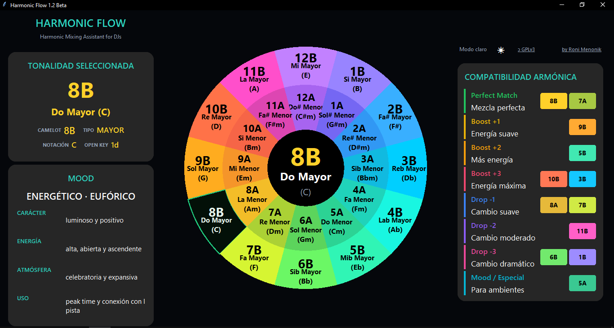

# Harmonic Flow

**Version 1.2 Beta · Windows**

[Download for Windows](https://github.com/Mnomik/Harmonic-Flow/releases/download/v1.2.0-beta/HarmonicFlow_1.2_Beta_Setup.exe) · [Release notes](https://github.com/Mnomik/Harmonic-Flow/releases/tag/v1.2.0-beta)

An interactive Camelot wheel for DJs, for preparing sets and checking key compatibility during a live set.

Select a key on the wheel to highlight compatible keys. The side panels show the selected key and its details at a glance.

## Before the set

Use the Camelot codes in your DJ library to explore compatible tracks, plan transitions and test possible sequences.

## During the set

Select the key of the track you are playing to quickly see which keys could work for the next mix.

Additional interface languages are on the way.

## License

Harmonic Flow is licensed under the GNU General Public License, version 3 or any later version (`GPL-3.0-or-later`). See [LICENSE](LICENSE) for the full text.

Developed by [Mnomic](https://github.com/Mnomik).
